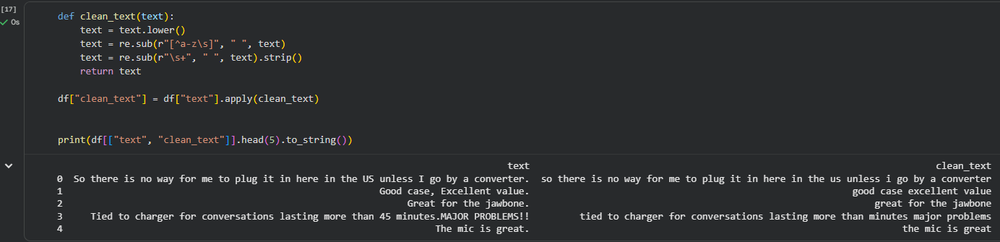
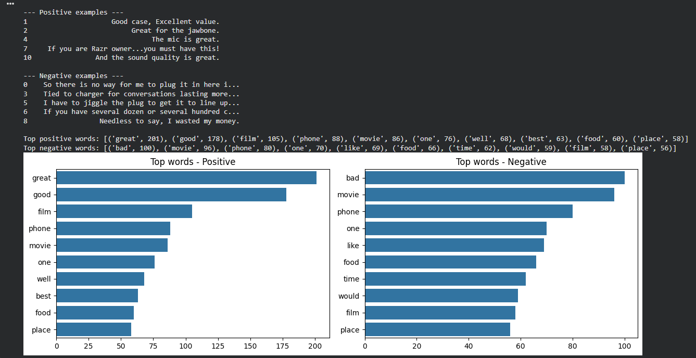
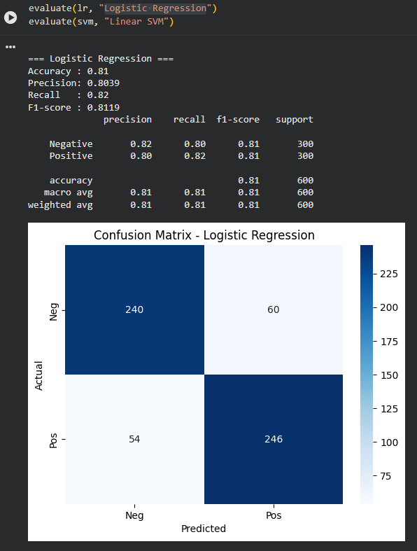
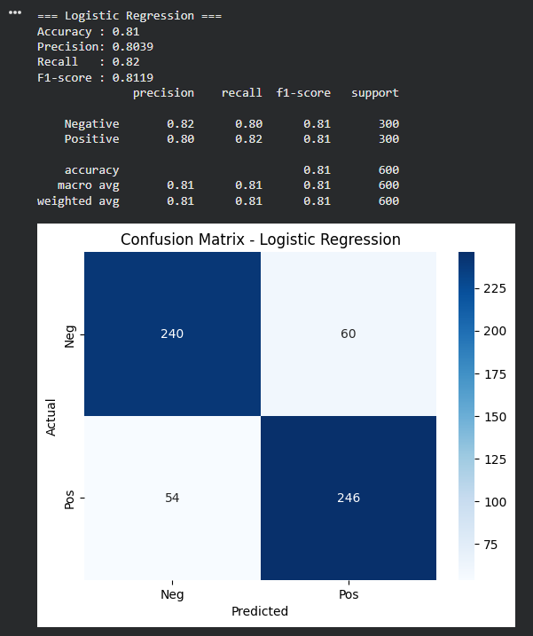
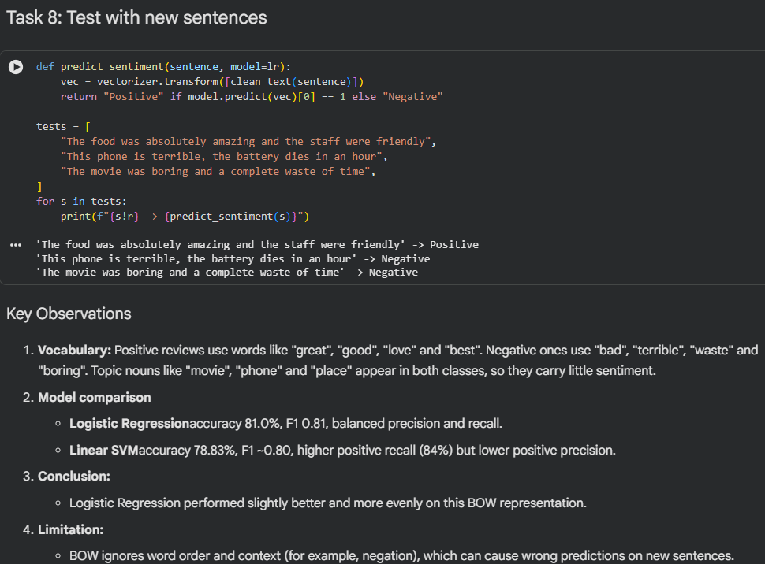

# Sentiment Analysis Using Traditional Machine Learning

Lab 1 for **PUSL 3205 – Large Language Models and Generative AI** (NSBM Green University / University of Plymouth).

A simple sentiment classifier that predicts whether a sentence is **positive** or **negative**, built with text preprocessing, Bag-of-Words and classic ML models.

## Dataset

[Sentiment Labelled Sentences (UCI)](https://archive.ics.uci.edu/dataset/331/sentiment%2Blabelled%2Bsentences)
- 3,000 sentences from Amazon, IMDb and Yelp
- Labels: `1` = positive, `0` = negative

## What the notebook does

1. Load and merge the dataset
2. Preprocess text (lowercase, remove punctuation, remove extra whitespace)
3. Explore data (examples, most frequent words)
4. Split data (80% train / 20% test)
5. Create Bag-of-Words features
6. Train Logistic Regression and Linear SVM
7. Evaluate (Accuracy, Precision, Recall, F1, confusion matrix)
8. Predict sentiment of new sentences

## Tech stack

Python, Pandas, NumPy, NLTK, Scikit-learn, Matplotlib, Seaborn

## Results

| Model | Accuracy | F1-score |
|---|---|---|
| Logistic Regression | 81.0% | 0.81 |
| Linear SVM | 78.83% | ~0.80 |

**Key observations**
- Positive reviews use words like "great", "good", "love", "best". Negative ones use "bad", "terrible", "waste", "boring".
- Topic words like "movie", "phone", "place" appear in both classes, so they carry little sentiment.
- Logistic Regression performed slightly better and more evenly. The SVM had higher positive recall (84%) but lower positive precision.
- Limitation: Bag-of-Words ignores word order and context (e.g. negation like "not good").

## Screenshots

### Original vs cleaned text


### Most frequent words


### Evaluation metrics


### Confusion matrices


### Predictions on new sentences


## How to run

1. Open `notebook/lab1_sentiment_analysis.ipynb` in Google Colab (or Jupyter).
2. Run all cells from top to bottom.

```bash
pip install pandas numpy nltk scikit-learn matplotlib seaborn
```


