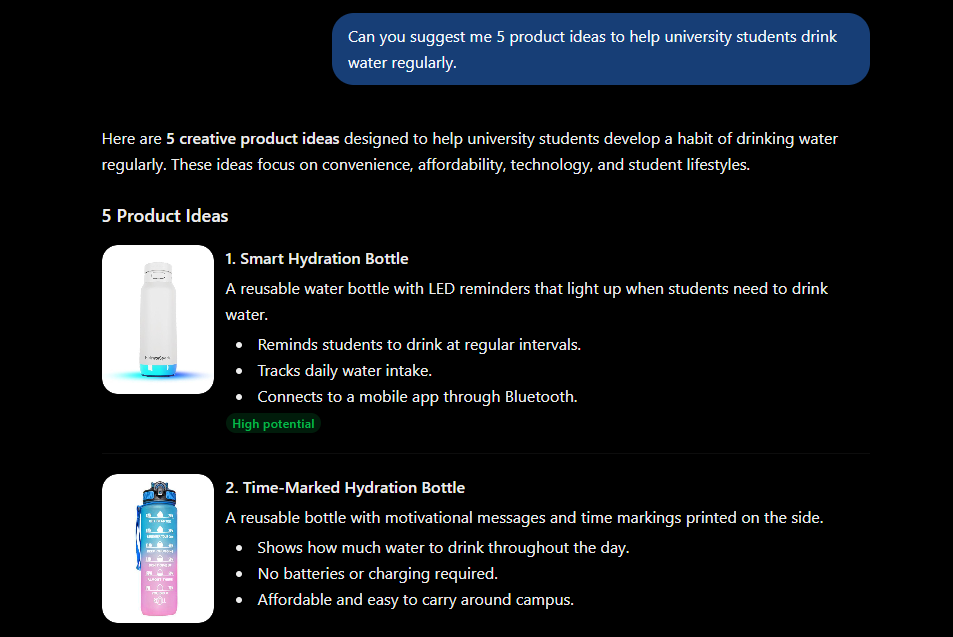
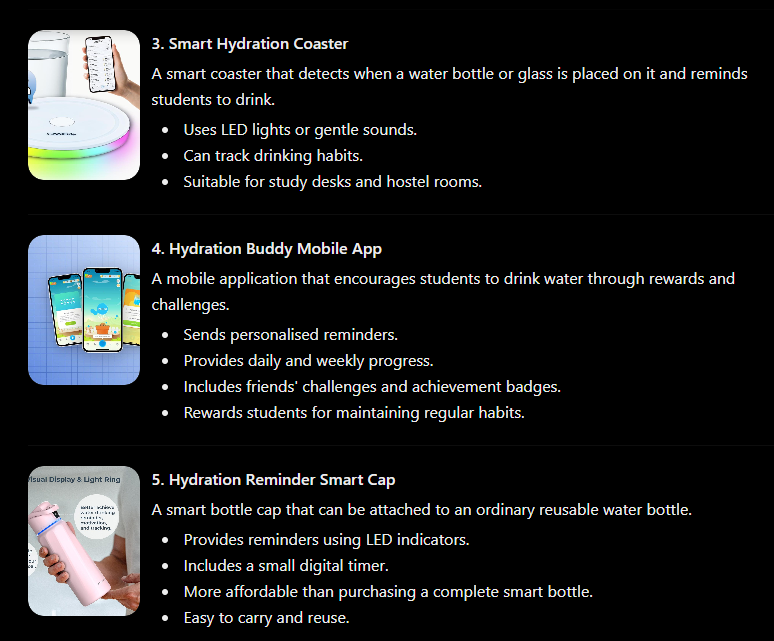
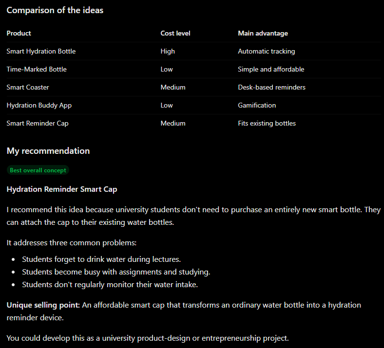
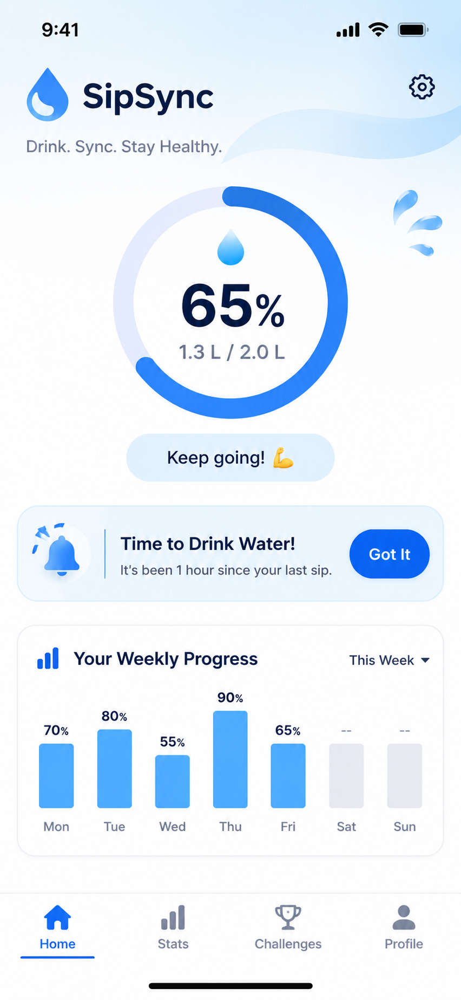

# Lab 02 – AI in Everyday Challenges

**PUSL 3205 – Large Language Models and Generative AI**

Individual lab: use an LLM as a product-development partner to solve an everyday student problem.

## Challenge chosen

**Group 4 – The Dehydrated Student**
Students spend hours in lectures, labs and study sessions without realising they've barely had any water. The goal is a product that encourages better drinking habits throughout the day.

## Product: SipSync (Hydration Reminder Smart Cap)

An affordable smart cap that attaches to any ordinary reusable bottle and turns it into a hydration reminder device, linked to a simple phone app.

**Target user:** university students (18-25) who forget to drink water during lectures, labs and study time.

**Key features**
- LED indicator and small timer on the cap to remind students to drink
- Sensor tracks sips and daily water intake
- App reminders linked to the class timetable (e.g. "Lecture ends in 10 min, drink up")
- Daily goal ring, streaks and friend challenges
- Weekly summary of drinking habits
- Fits existing bottles, so there's no need to buy a full smart bottle

## How the LLM was used

1. **Idea generation:** asked the LLM for 5 product ideas to help students drink water regularly.
2. **Comparison:** asked it to compare the ideas by cost and main advantage.
3. **Selection:** the LLM recommended the Hydration Reminder Smart Cap as the best overall concept, because students can keep their existing bottles.
4. **Refinement:** used the LLM to name the product, define the target user, list key features and design the mock-up.

### 5 ideas suggested
1. Smart Hydration Bottle
2. Time-Marked Hydration Bottle
3. Smart Hydration Coaster
4. Hydration Buddy Mobile App
5. Hydration Reminder Smart Cap (selected)

| Product | Cost level | Main advantage |
|---|---|---|
| Smart Hydration Bottle | High | Automatic tracking |
| Time-Marked Bottle | Low | Simple and affordable |
| Smart Coaster | Medium | Desk-based reminders |
| Hydration Buddy App | Low | Gamification |
| Smart Reminder Cap | Medium | Fits existing bottles |

## Screenshots

### Prompt and first ideas

### Ideas 3-5

### Comparison and recommendation

### Visual prototype (mock-up)

