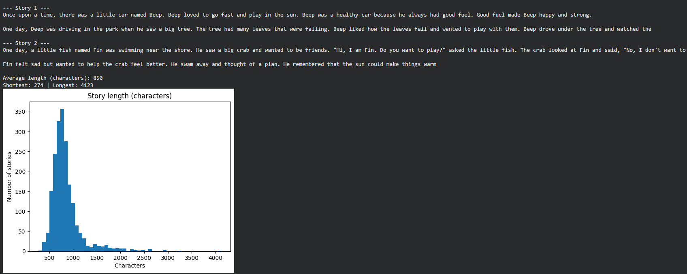
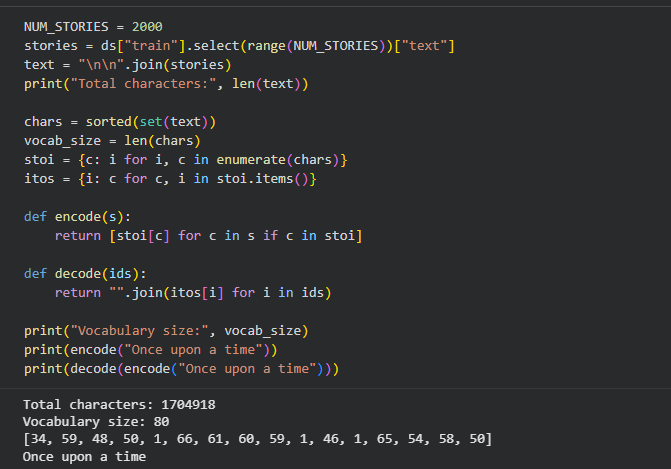
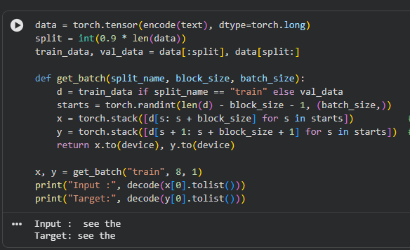
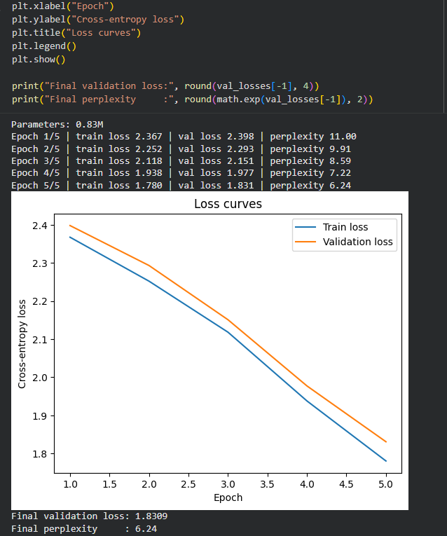
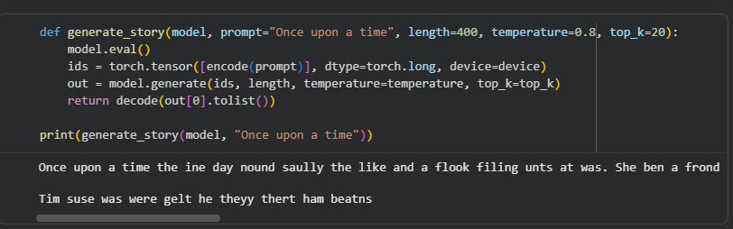
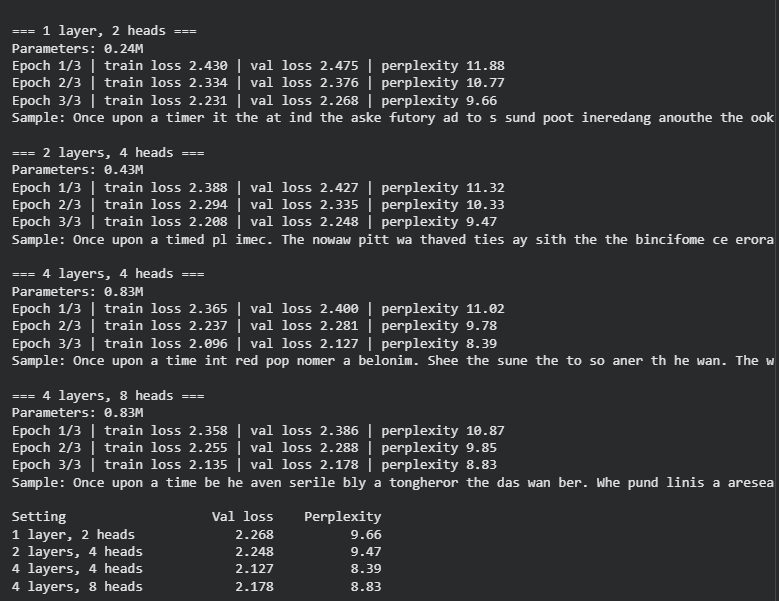

# Lab 03 – Developing a Tiny Transformer Language Model

**PUSL 3205 – Large Language Models and Generative AI**

A small character-level Transformer (decoder-only) built from scratch in PyTorch and trained on the TinyStories dataset to generate short stories.

## Dataset

[TinyStories](https://huggingface.co/datasets/roneneldan/TinyStories)
- Short stories written in simple vocabulary and grammar
- 5,000 stories used 
- Character-level tokenizer, vocabulary size: **80**

## Model

| Setting | Value |
|---|---|
| Layers | 4 |
| Attention heads | 6 |
| Embedding size | 192 |
| Context length (`block_size`) | 256 |
| Parameters | **0.83M** |
| Optimizer | AdamW with warm-up and cosine decay |

Main components: token + positional embeddings, masked multi-head self-attention, feed-forward layers (GELU), residual connections, LayerNorm and dropout.

## What the notebook does

1. Load and explore the dataset
2. Preprocess text with a character-level tokenizer
3. Prepare training data (input `x`, target `y` shifted by one character)
4. Build the Transformer
5. Train and monitor loss
6. Evaluate with loss curves and perplexity
7. Generate stories
8. Experiment with layers and heads
9. Save and reload the trained model

## Results

- Final validation loss: **1.8309**
- Final perplexity: **6.24**

### Experiments (800 steps each)

| Setting | Val loss | Perplexity |
|---|---|---|
| 1 layer, 2 heads  | 2.268| 9.66 |
| 2 layers, 4 heads | 2.248| 9.47 |
| 4 layers, 4 heads | 2.127| 8.39 |
| 4 layers, 8 heads | 2.178| 8.83 |

## Key observations

**Dataset**
- TinyStories uses simple vocabulary and grammar, so a tiny model (under 2.5M parameters) can learn mostly coherent sentences.
- Stories are short, which suits a limited context window (`block_size = 256`).

**Architecture**
- The causal mask (`torch.tril`) stops the model seeing future characters, so it must learn to predict the next one. This is what makes generation possible.
- Residual connections and LayerNorm keep gradients stable, which makes deeper stacks trainable.

**Hyperparameters**
- Deeper models reached lower loss than shallower ones in the experiments above. Adding heads changed the result less, because heads split the same embedding size instead of adding capacity.
- The character-level vocabulary is small, but the model has to learn spelling first, and the short context limits long-range story structure.

## Screenshots

### Dataset exploration

### Vocabulary and model size

### Training log

### Loss curves

### Generated story

### Experiment comparison

