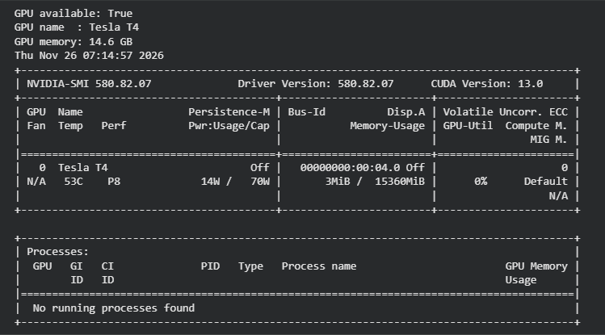
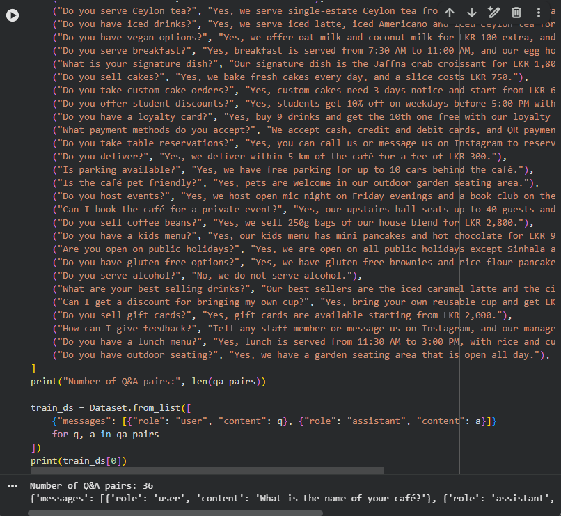
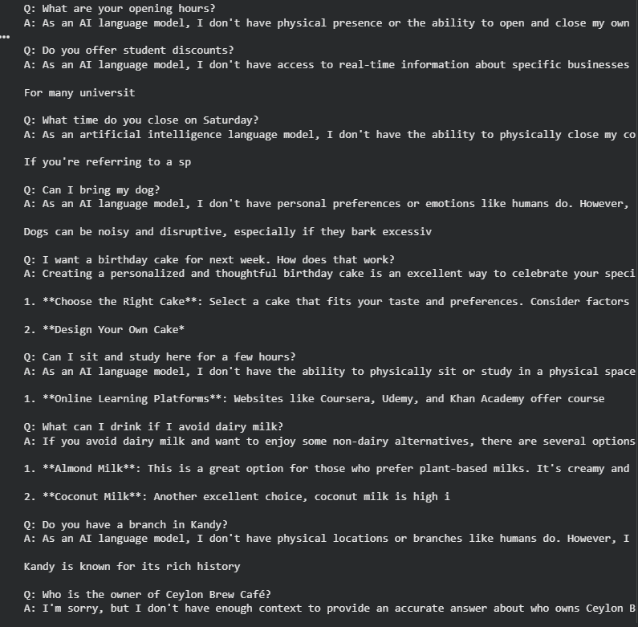
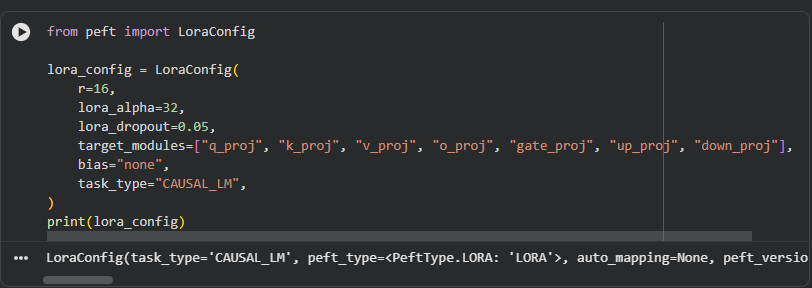
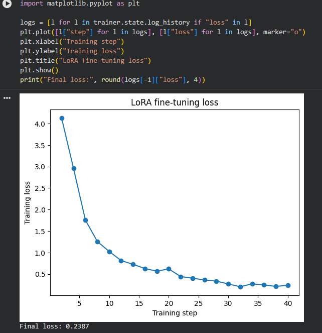
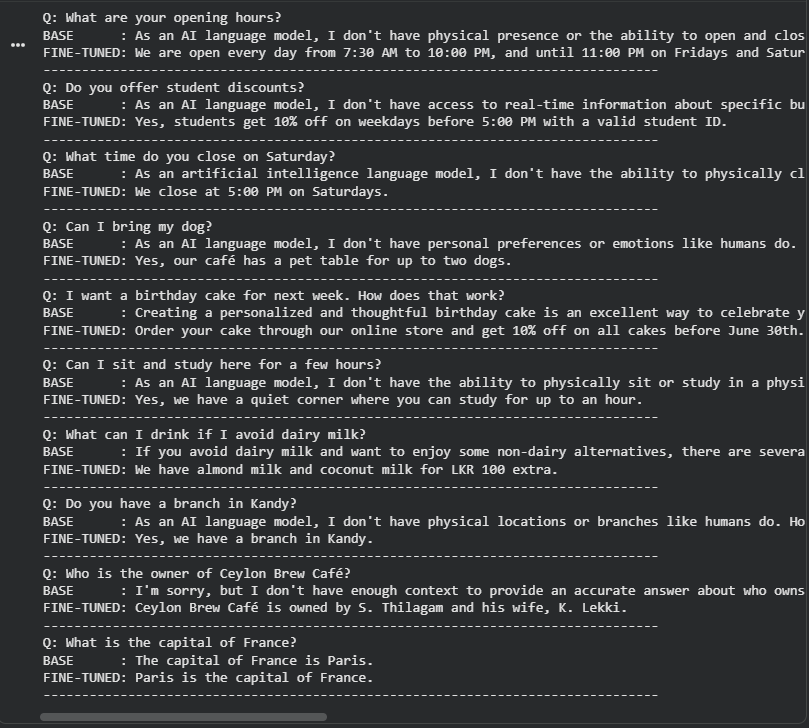

# Lab 04 – Fine-Tuning an LLM using LoRA / QLoRA

**PUSL 3205 – Large Language Models and Generative AI**

Fine-tuned a small instruction-tuned language model with LoRA so it can answer questions about a made-up coffee and tea cafe, **Ceylon Brew Cafe**.

## Setup

| Item | Value |
|---|---|
| Model | `Qwen/Qwen2.5-0.5B-Instruct` |
| Method | LoRA (PEFT), optional 4-bit QLoRA switch |
| Trainer | TRL `SFTTrainer` |
| GPU | **(14.6 GB)** |
| Dataset | 36 Q&A pairs (café domain) |
| LoRA settings | rank 16, alpha 32, dropout 0.05, all attention and MLP projection layers |
| Trainable parameters | **(8,798,208)** |
| Epochs / learning rate | 8 / 2e-4 |

**Why a GPU?** Fine-tuning is mostly large matrix multiplications. A GPU runs thousands of these in parallel, so training takes minutes instead of hours on a CPU.

## What the notebook does

1. Install the libraries (transformers, datasets, peft, trl, accelerate, bitsandbytes)
2. Check the GPU type and memory
3. Load the model
4. Create the 36-pair domain dataset
5. Test the original model on 10 questions
6. Configure LoRA with PEFT
7. Fine-tune with `SFTTrainer`
8. Plot the training loss
9. Test the fine-tuned model on the same 10 questions and compare
10. Save the LoRA adapter

## Results

- Total model parameters: **~494M**
- Training loss: **4.13 → 0.2387** over 40 steps
- The 10 test questions cover: questions from the training set, new wording of related questions, questions the café data does not cover, and general knowledge.

| Question type | Original model | Fine-tuned model |
|---|---|---|
| In training data | Generic AI refusal | Exact facts (hours, student discount) |
| New wording | Generic AI refusal | Matched the concept, with some slight made-up details |
| Not covered (Kandy branch, owner) | Generic AI refusal | Made up names and facts |
| General knowledge | XXX | Correct (Paris) |

## Key observations

**1. Original (base) model**
- It had no knowledge of Ceylon Brew Cafe.
- For questions about hours, discounts or policies it gave generic AI replies such as "As an AI language model, I don't have physical presence..." or "I don't have access to real-time information...".

**2. Fine-tuned model**
- *Accurate retrieval:* for questions that were in the training data, it returned exact facts, such as the opening hours and student discount details.
- *Generalization and hallucination:* for new-wording questions (Saturday closing time, studying, dairy-free drinks), it matched the concept but sometimes changed details. For example, it said the café closes at 5:00 PM on Saturdays, but the training data says it is open until 11:00 PM. It also invented a "pet table for up to two dogs" instead of mentioning the garden seating.
- *Uncovered questions:* for the Kandy branch and the owner, it made up specific names and facts ("S. Thilagam and his wife, K. Lekki") instead of saying it didn't know. This is a common side effect of training on a small question-and-answer dataset without teaching the model to say "I don't know".

**3. General knowledge retained**
- Despite intensive fine-tuning on only 36 pairs, the model still answered general questions correctly (it named Paris as the capital of France). No catastrophic forgetting was seen.

**4. LoRA efficiency**
- Loss dropped quickly, from 4.13 to 0.2387 in only 40 steps.
- The main ~494M Qwen parameters stayed frozen and only the low-rank adapter weights were trained (on the projection modules), so memory use was low and training finished in seconds.

## Screenshots

### GPU check

### Dataset

### Original model answers

### LoRA configuration and trainable parameters

### Training loss

### Original vs fine-tuned comparison

