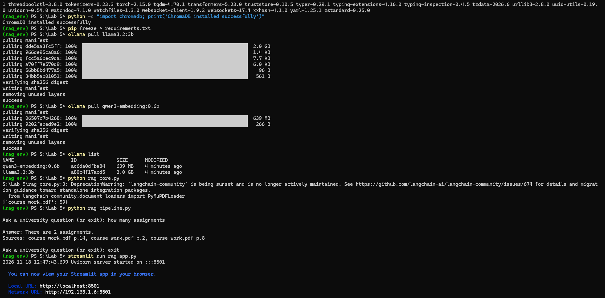
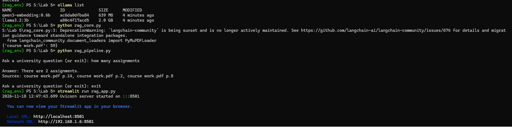
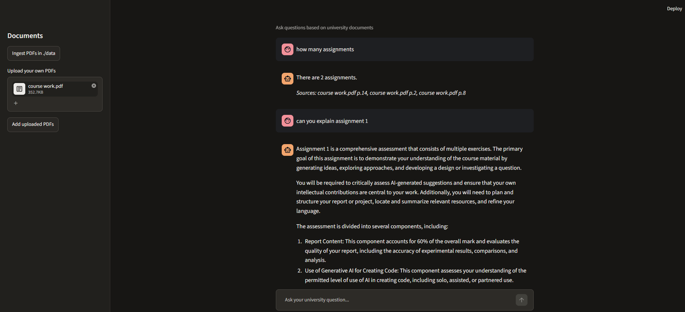
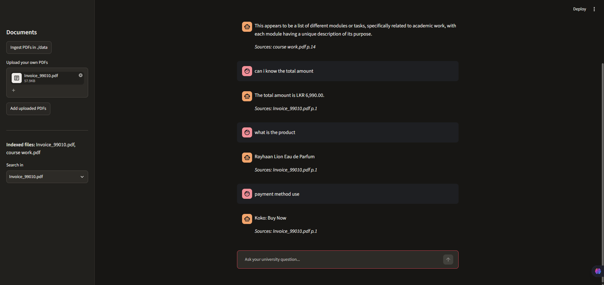

# Lab 05 – RAG Architecture: University AI Assistant (Multi-PDF)

**PUSL 3205 – Large Language Models and Generative AI**

A Retrieval-Augmented Generation (RAG) app that answers questions from PDF documents. It reads **multiple PDFs** and lets users **upload their own PDFs** from the chat window.

## Tech stack

| Part | Tool |
|---|---|
| LLM | Llama 3.2 3B (Ollama) |
| Embedding model | Qwen3 Embedding 0.6B (Ollama) |
| Vector database | ChromaDB |
| Framework | LangChain |
| PDF reader | PyMuPDF |
| UI | Streamlit |

## How it works

1. **Load:** PDFs are read page by page.
2. **Split:** the text is cut into chunks.
3. **Embed and store:** chunks are embedded and saved in ChromaDB, tagged with the PDF name.
4. **Retrieve:** the chunks most similar to the question are fetched.
5. **Generate:** the LLM answers from those chunks, and the app shows the source PDF and page.

## Features added for the lab task

- **Multiple PDFs:** the "Ingest PDFs in ./data" button indexes every PDF in the `data/` folder.
- **Upload in the app:** the sidebar uploader adds new PDFs, which can be used straight away.
- **Search filter:** a "Search in" dropdown limits answers to one chosen document.
- **Sources shown:** each answer lists the PDF name and page number.

## Files

```
Lab-05-RAG-Multi-PDF/
├── rag_app.py         Streamlit app (chat + upload)
├── rag_core.py        load, split, embed, store, retrieve, answer
├── rag_pipeline.py    terminal chat
├── requirements.txt
├── data/              PDFs to index
└── screenshots/
```

## Setup

```powershell
py -3.12 -m venv rag_env
.\rag_env\Scripts\Activate.ps1
python -m pip install --upgrade pip
pip install -r requirements.txt

ollama pull llama3.2:3b
ollama pull qwen3-embedding:0.6b
ollama list
```

## Run

```powershell
python rag_core.py          # index the PDFs in data/
python rag_pipeline.py      # terminal chat
streamlit run rag_app.py    # chat window with PDF upload
```

## Results

| Test | Question | Result |
|---|---|---|
| Terminal chat | "how many assignments" | Answered from the coursework PDF and cited pages 14, 2 and 8 |
| Course PDF in app | "can you explain assignment 1" | Gave a detailed answer based on the coursework PDF |
| Uploaded PDF | "can i know the total amount" | Answered correctly from the uploaded invoice, page 1 |
| Uploaded PDF | "what is the product" | Returned the product name from the invoice, page 1 |
| Uploaded PDF | "payment method use" | Returned the payment method from the invoice, page 1 |

## Key observations

- The app correctly answered questions from **two different PDFs** and cited the source file and page each time.
- A newly uploaded PDF was usable straight after clicking "Add uploaded PDFs", with no restart.
- Specific questions (totals, names, counts) worked best.
- Vague questions such as "what is this about" retrieved weaker context, and the answer described the wrong document.
- Limitation: answers depend on the retrieved chunks. If the right chunk is not retrieved, the answer can be incomplete or wrong, so the source pages should be checked.

## Screenshots

### Setup and Ollama models


### Terminal chat


### Streamlit app with the coursework PDF


### Uploading a new PDF and asking about it


## Author

Sakya – Data Science undergraduate, NSBM Green University
